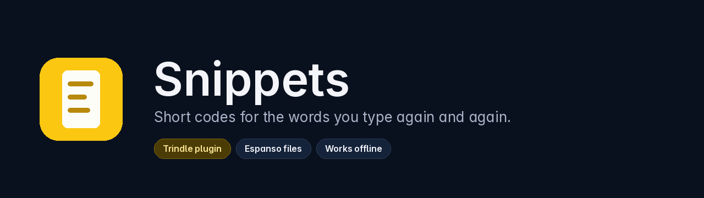
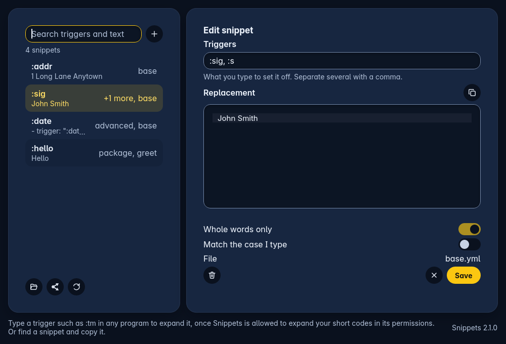
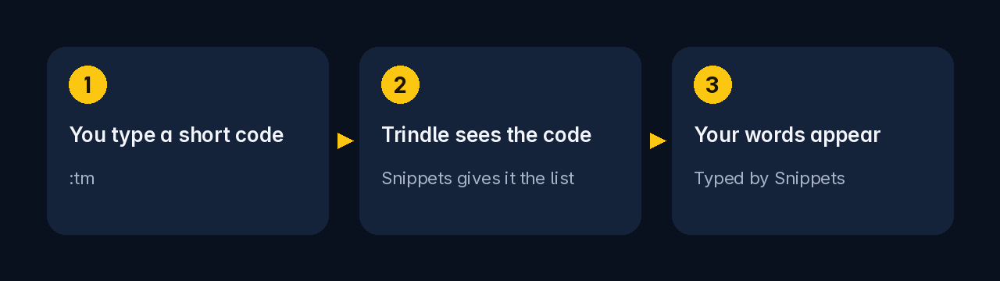

<p align="center">
  
</p>

<p align="center">
  
  
  
  
</p>

Snippets is a Trindle plugin that keeps your text snippets in one searchable list: a short trigger such as `:tm` and the words it stands for. You add, change and remove snippets with a form, not by editing YAML.

Your snippets stay in plain files in Espanso's format, so you can move between Snippets and Espanso whenever you like. Snippets makes no network connections and changes only the lines you changed.

<p align="center">
  
</p>

The picture is the window drawn by Snippets itself from made-up sample snippets.

## How it works

<p align="center">
  
</p>

Snippets cannot see your keys. It writes a plain list of your snippets, and Trindle, once you allow it, watches for the codes and types the words for you.

## Quick start

1. Install Snippets from Apps in Trindle.
2. When Trindle asks, allow `expand`. Without it Snippets still lists, edits and copies your snippets, but nothing is typed for you.
3. Open Snippets. A fresh install has one snippet, `:tm`.
4. In any program, type `:tm`. It turns into "Typed by Snippets".

The icon Snippets puts in the ring has a menu with **Turn typing expansion off** and **Turn typing expansion on**, so you can switch it off without removing anything.

## What it does

- Lists every snippet, and the search marks the letters it matched in triggers, labels and replacements.
- Adds, changes and deletes snippets. Delete asks twice and can be put back.
- Leaves your files as you wrote them. Only the lines of the values you changed are rewritten, so comments, order, blank lines and quoting stay. Each save keeps a private copy of the file first, 20 per file, and is refused if that copy cannot be made.
- Shows snippets with variables, forms or scripts exactly as they are in the file, read-only, and never rewrites them.
- Keeps what you have typed if you pick another snippet by mistake or close the window (a copy is put beside the backups as `unsaved.txt`).
- Exports every snippet file as one `.tar.gz` and imports `.yml`, `.yaml` or `.tar.gz` files beside the ones you have, never over them. An import that holds shell or script variables names the files and waits for a yes.
- Copies a snippet's words to paste anywhere.
- Opens one window only: starting it again brings the first to the front.

## Typing expansion

When you allow `expand` in its permissions, Snippets writes the plain snippets (no variables, forms or scripts, triggers of three to 32 characters without spaces) to `expansions.json` in its own home, and Trindle expands them as you type. Snippets with variables, forms or scripts can be found and copied but do not expand. The format is in [docs/TRIGGER-DOOR.md](docs/TRIGGER-DOOR.md).

## Settings

Snippets has no settings page of its own. What it may do is set by the permissions Trindle shows when you install it.

| Permission | Required | Default | What it does |
|---|---|---|---|
| `files` | Yes | Allowed on install | Reads and writes your snippet files, its backups and its own home. |
| `expand` | No | Off until you allow it | Lets Trindle type your plain snippets when you type their codes. |

## Where your data lives

| What | Where |
|---|---|
| Snippet files | `~/.config/espanso/match/*.yml` (or `~/.espanso/match/` where that already holds them); as a plugin, `~` is the plugin's own home |
| Backups | `~/.local/share/snippets/backups` |
| List for typing expansion | `expansions.json` in the plugin's home |

Snippets reads and writes Espanso's file format, so snippets move between Snippets and Espanso.

## Security

Snippets makes no network connections and runs no other program. It writes only inside the snippet folder, its backups folder and its own home, and an imported archive is read in memory with limits. [SECURITY.md](SECURITY.md) has the detail and how to report a problem.

## Building it yourself

Snippets builds against the public [Trindle Toolkit](https://github.com/trindle-os/trindle-toolkit), pinned in `Cargo.toml` to one commit, so a plain `cargo test` fetches it and needs nothing else. Rust 1.85 or newer builds it (Debian 13's compiler is enough).

```bash
cargo test
cargo build --release
sh packaging/trindle-plugin.sh
```

The last command builds `dist/trindle-plugin/org.trindle.Snippets.tar.zst` and checks it with `trindle-plugin`. The pictures in `docs/images` are drawn by `docs/images/sources/make_images.py` and by the window itself.

## Reporting a problem

Report bugs and crashes on [Buildmorphic](https://buildmorphic.com). Security problems go private, as [SECURITY.md](SECURITY.md) says. More in [CONTRIBUTING.md](CONTRIBUTING.md).

## Licence

Snippets is free software under the GNU General Public License, version 3 or any later version, and belongs to the Trindle project. The full text is in [LICENSE](LICENSE). What changed in each version is in [CHANGELOG.md](CHANGELOG.md).

## Disclaimer

Snippets is provided as it is, without any warranty. Keep your own copy of your snippet files; Snippets keeps 20 backups of each, but a backup beside the original is not a substitute for yours.

Comments are stripped from the published code to keep it lean.
